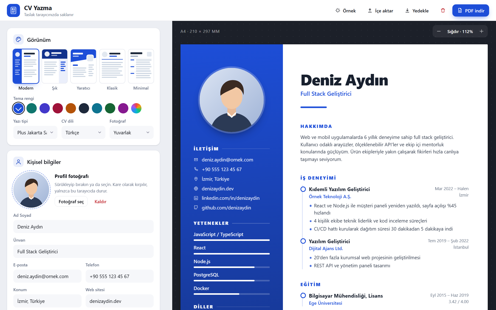

# CV Yazma

Tarayıcıda çalışan, **fotoğraflı** ve **şablonlu** ücretsiz CV oluşturucu.
Kurulum gerektirmez, verileriniz hiçbir sunucuya gönderilmez.

<!-- Ekran görüntüsü eklemek için: docs/ekran.png dosyasını koyup aşağıdaki satırı açın -->
<!--  -->

## Özellikler

- 📸 Fotoğraf yükleme (sürükle-bırak), yuvarlak / yumuşak köşe / kare
- 🎨 5 şablon: **Modern**, **Şık**, **Yaratıcı**, **Klasik**, **Minimal** (görsel küçük resimlerle seçilir)
- 🖌️ Tema rengi (arayüz de bu renge uyar) ve 8 yazı tipi
- 🔍 Yakınlaştırılabilir önizleme, telefonda Düzenle / Önizle sekmeleri
- 🌐 CV dili: Türkçe veya İngilizce başlıklar
- 👀 Canlı A4 önizleme
- 📄 Tek tıkla PDF (tarayıcının "PDF olarak kaydet" seçeneği)
- 💾 Otomatik kayıt (tarayıcıda) + JSON olarak içe/dışa aktarma
- 📱 Mobil uyumlu, karanlık mod destekli arayüz

Bölümler: kişisel bilgiler, hakkımda, iş deneyimi, eğitim, projeler,
sertifikalar, yetenekler (seviyeli), diller, referanslar, ilgi alanları.

## Kullanım

### Doğrudan açın
`index.html` dosyasına çift tıklayın. Bu kadar.

### Yerel sunucu ile (isteğe bağlı)
```bash
python -m http.server 8000
```
Ardından tarayıcıda `http://localhost:8000` adresini açın.

### PDF almak
**PDF indir** butonuna basın, açılan pencerede hedef olarak
**PDF olarak kaydet**'i seçin. En iyi sonuç için:
- Kenar boşlukları: **Yok**
- **Arka plan grafikleri** seçeneğini açık tutun

## GitHub Pages'te yayınlama

1. Bu depoyu GitHub'a gönderin (`main` dalı).
2. Depoda **Settings → Pages → Build and deployment → Source** kısmından **GitHub Actions** seçin.
3. Her `main` push'unda `.github/workflows/pages.yml` siteyi otomatik yayınlar:
   `https://<kullanici-adi>.github.io/<depo-adi>/`

## Gizlilik

- Tüm veriler yalnızca tarayıcınızın `localStorage` alanında tutulur.
- **Yedekle** ile aldığınız `cv-*.json` dosyaları `.gitignore` sayesinde
  depoya yanlışlıkla eklenmez. Kişisel CV'nizi herkese açık depoya koymayın.

## Proje yapısı

```
index.html          Arayüz iskeleti
css/app.css         Düzenleyici ve önizleme arayüzü
css/cv.css          CV sayfası, şablonlar ve yazdırma stilleri
js/schema.js        Veri modeli ve form alan tanımları
js/store.js         Durum, otomatik kayıt, JSON içe/dışa aktarma
js/render.js        CV'yi şablona göre HTML'e çevirir
js/editor.js        Form bağlama, liste bölümleri, fotoğraf
js/i18n.js          CV başlıklarının TR/EN çevirileri
js/icons.js         Arayüz ikonları
js/sample.js        Örnek CV verisi
js/app.js           Başlatma ve üst menü işlemleri
```

Derleme adımı yok; düz HTML/CSS/JavaScript.

### Yeni bölüm eklemek
1. `js/schema.js` → `CV.LIST_SECTIONS` içine alan tanımı ve `emptyState`'e boş dizi
2. `js/i18n.js` → başlık çevirisi
3. `js/render.js` → `parts` içine çıktı fonksiyonu ve şablonlarda yerleşimi

### Yeni şablon eklemek
1. `js/render.js` → `templates` nesnesine fonksiyon
2. `css/cv.css` → `.tpl-<ad>` stilleri
3. `js/schema.js` → `CV.TEMPLATES` listesine ad, `js/editor.js` → `THUMBS` içine küçük resim

## Lisans

[MIT](LICENSE)
